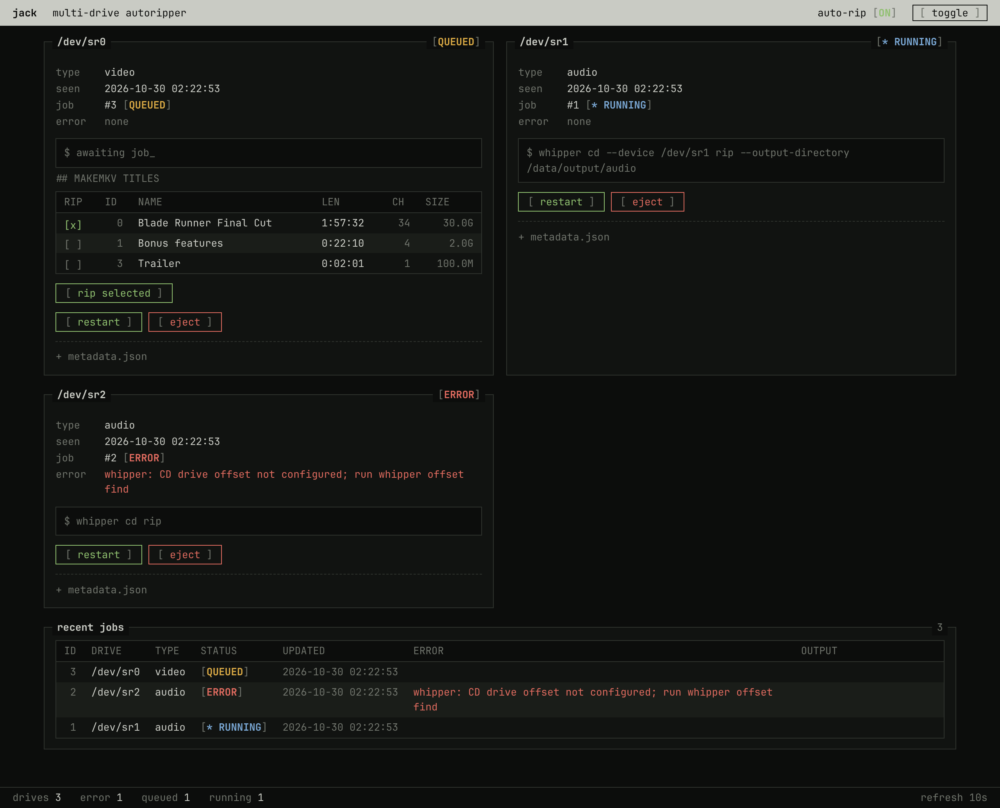
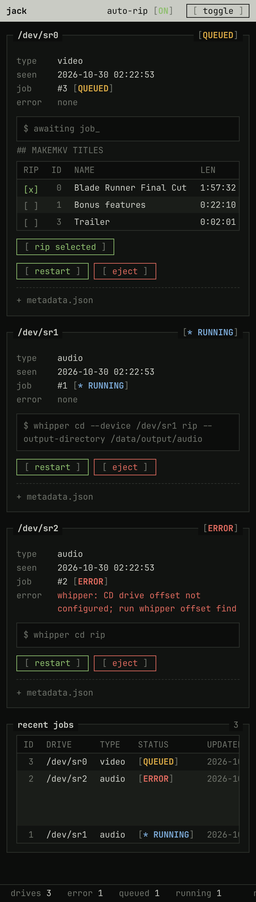

# jack

note: *partially* vibecoded using copilot

jack is a minimal multi-drive autoripper built in Python 3. It uses udev to queue discs, MakeMKV for video, whipper for audio, and a lightweight web UI to monitor and control jobs.



<details>
<summary>Mobile view</summary>



</details>

## Features
- Ubuntu 24.04 Docker image
- udev-triggered disc detection
- MakeMKV video ripping
- whipper audio ripping to FLAC
- Simple web UI for status, errors, eject, restart, manual metadata JSON, and MakeMKV track selection before video ripping
- Multiple drive support
- Optional success and error webhooks

## Build
```bash
docker build -t jack .
```

## Run
```bash
docker run --rm -it \
  --privileged \
  -p 8080:8080 \
  -v jack-state:/var/lib/jack \
  -v "$PWD/output:/data/output" \
  --device /dev/sr0 \
  --device /dev/sr1 \
  jack
```

The container should run privileged so udev can observe optical drive media changes. Visit `http://localhost:8080` to see jobs, eject drives, retry work, or update metadata for the next queued audio rip.

## Manual queueing
```bash
python3 -m jack scan --device /dev/sr0 --disc-type audio --metadata '{"artist":"Example","album":"Example Album"}'
```

## Webhooks
Set any of the following environment variables:
- `JACK_WEBHOOK_URL`
- `JACK_WEBHOOK_SUCCESS_URL`
- `JACK_WEBHOOK_ERROR_URL`
- `JACK_WEBHOOK_HEADER` (optional, format: `Header-Name: value`)
